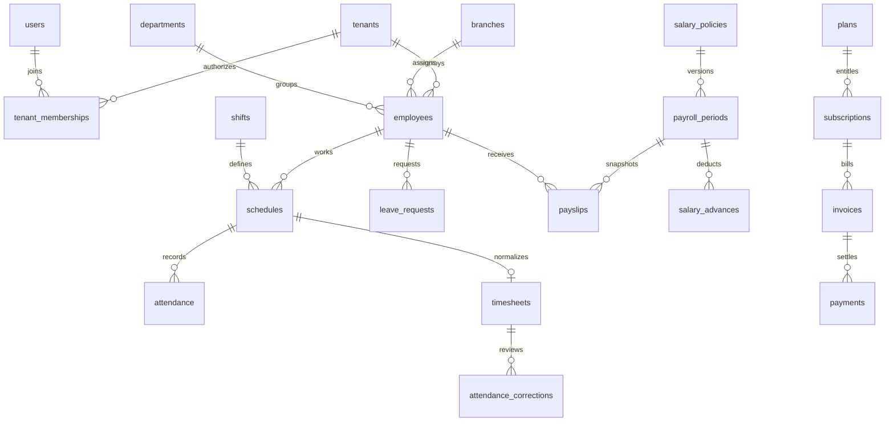

# Database model

Production uses MySQL 8, InnoDB and utf8mb4. Run the authoritative CodeIgniter migrations under `backend/app/Database/Migrations`; do not initialize production by importing a demo database. `schema.mysql.sql` is a schema-only reference exported from the locally tested MySQL instance. It contains no user, company, credential or payroll rows. Migration files remain the source of truth.

Global tables: users, auth tokens/challenges, login attempts, roles, permissions, plans, settings and platform audit. Tenants are the isolation root. All operational, billing, queue, private-file and company-audit records carry `tenant_id`. Relationships between tenant resources use composite ownership foreign keys on MySQL. Global user relationships are checked against membership by services.

Notable unique keys protect employee code within a tenant, one timesheet per assignment, one payslip per employee/period, schedule duplicates, attendance UUIDs, provider/payment references, notification event/user combinations and queue event/channel combinations. Tenant/deleted indexes support scoped live reads; composite `(tenant_id,id)` keys enforce resource ownership. Historical employees are archived, and payroll input snapshots retain the policy and approved source values used for each calculation.

Money uses signed BIGINT integer VND. Intermediate arithmetic uses BCMath. Latitude/longitude are decimal measurements, not monetary values. UTC event strings and local work dates are separate; the assigned branch/company timezone determines shift boundaries. JSON fields contain validated serialized configuration or immutable calculation evidence.
